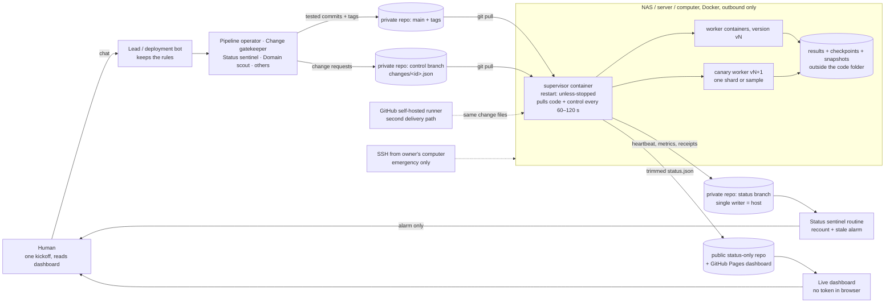

# The NAS Offload Guide: best practices for running large, long autonomous projects with AI agents

**Shareable and field-agnostic.** This guide works for any field, any large language model (LLM), any operating system (OS) and any compute host:
- a network-attached storage (NAS) box, meaning an always-on storage device that can also run programs
- a network server or virtual machine (VM)
- a local computer

**Preferred path:** a Grok Bot team + Grok Build + NAS + GitHub. Every other platform can follow the same protocol; only the launcher changes.

**How claims are labeled:**
- **UNVERIFIED:** the claim could not be confirmed.
- **INFERENCE:** the claim is reasoned from evidence rather than read directly from a source.

This guide contains best practices only. It has no project examples or case studies. Text inside `<angle brackets>` is a placeholder for you to fill in.

---

## 0. Contents

1. Purpose
2. The preferred path and the alternatives
3. Compute hosts, including the local-computer one-approval pattern
4. Reference architecture
5. Live-change (injection) protocol
6. Dashboard standard
7. Autonomy matrix and interrupt budget
8. Sturdiness practices
9. Team of bots, by role
10. Field-agnostic kickoff
11. Copy-paste prompt library (preferred path)
12. Platform variants: ChatGPT/Codex, Claude Code, GitHub Copilot, others
13. Codex explainer
14. One-page checklist
15. Appendix A: private dashboard options
16. Appendix B: sources
17. Appendix C: unverified items

---

## 1. Purpose

**This guide is for anyone who wants an AI agent to run a job that lasts hours or days** on hardware they own, with the AI acting like a capable engineer in its own workspace. The AI:
- plans
- researches how the field already solves the problem
- builds and tests
- deploys
- watches
- fixes
- reports

The human states the goal and the limits, then mostly reads a live dashboard.

**Why offload to your own hardware?** AI usage is metered. A job that loops inside a chat burns the allowance. Code running on a NAS, server or always-on computer costs nothing per hour in AI usage. The AI's job becomes building, supervising and improving the code, not *being* the loop.

**What "good" looks like:**
1. One kickoff message.
2. Then a live dashboard and the occasional short report.
3. Every change arrives with a receipt.
4. Failures roll themselves back.
5. The human is asked only about deleting data, spending money, publishing publicly, or anything out of scope.

**Core principles:**
- Build and test before deploying, never iterate live on the host.
- Ship one versioned package with one numbered install procedure and explicit checks.
- The host *pulls* changes; nothing pushes code into a running job.
- Every change leaves a receipt that proves which version is running.
- Code is kept separate from state and results.
- One control platform per project, one handoff file as the baton.
- Report honestly: "not delivered" and "unverified" are valid answers.

---

## 2. The preferred path and the alternatives

### 2a. Preferred path: Grok Bot team + Grok Build + NAS + GitHub

| Piece | Role | Why |
|---|---|---|
| **Grok Bot team** (a lead bot plus specialists, §9) | Control plane: plan, research, build, test, release, watch, report | Persistent bots with routines (scheduled or event-driven, at least 5 minutes apart, up to 50 per bot) ([xAI docs](https://docs.x.ai/grok-bot/skills-routines-and-automations)). One shared cloud computer to build and test on ([xAI docs](https://docs.x.ai/grok-bot/computer-and-apps)) |
| **Grok Build** | (1) a terminal agent on your own computer for the one-time host install; (2) a web app builder, only if the deliverable is an app | A command-line interface (CLI) with a headless mode (`grok -p`), Model Context Protocol (MCP) tools, hooks and subagents ([xAI Build docs](https://docs.x.ai/build/overview)). The web builder publishes to `grok.me` ([xAI news](https://x.ai/news/grok-build-for-everyone)) |
| **NAS / server / always-on computer** | Compute: runs the job in Docker (a tool that packages a program and everything it needs into a "container") under a supervisor | Costs no AI usage per hour |
| **GitHub** | The single source of truth: code, change requests, status and the handoff file | Versioned and auditable. Every platform can read it |

### 2b. Alternatives, per platform

| Platform | How to offload | How to monitor | How to inject | Usage model | Limits and failure modes |
|---|---|---|---|---|---|
| **Grok Bot** | Bot builds the package; the host supervisor pulls `main` and tags | A routine reads the `status` branch every 5–15 minutes | Commits a `control/changes/<id>.json` file | Weekly usage pool (details UNVERIFIED) | No direct host access except through GitHub, runners or approved local tools |
| **Grok Build CLI** | Run `grok -p "<task>"` headless on the host | Your own scripts | Same repository protocol | Subscription or application programming interface (API) billing (UNVERIFIED) | No transcript unless you save it. Best for setup, not supervision |
| **ChatGPT / Codex** | Codex CLI or `codex exec` on the host. Codex Cloud runs on OpenAI computers | ChatGPT scheduled tasks (hourly minimum; a small number of active tasks per plan) ([OpenAI Help](https://help.openai.com/en/articles/10291617-tasks-in-chatgpt)) | Same repository protocol | 5-hour window plus possible weekly limits; credits or an API key beyond that ([Codex pricing](https://developers.openai.com/codex/pricing/)) | The cloud version cannot reach a home local area network (LAN) without exposing it (INFERENCE). Usage caps and plan lapses stop work |
| **ChatGPT Voice** | Not a job runner | — | Voice steering only | ChatGPT plan | Hands heavier work to a model in the background ([OpenAI](https://openai.com/index/introducing-gpt-live/)) |
| **Claude Code** | `claude -p` headless on the host, or Remote Control on your own always-on computer. Self-hosted environments on Team/Enterprise plans ([docs](https://code.claude.com/docs/en/self-hosted-environments)) | Routines or scheduled tasks (at least 1 hour apart) ([docs](https://code.claude.com/docs/en/routines)) | Same repository protocol | 5-hour plus weekly limits, shared with Claude chat ([Claude Help](https://support.claude.com/en/articles/11145838-use-claude-code-with-your-pro-or-max-plan)) | Headless use may drain the allowance faster (UNVERIFIED) |
| **GitHub Copilot coding agent** | Assign an issue; it opens a pull request (PR) | PR comments | One PR per change | 1 premium request × model rate per session, plus 1 per steering comment ([GitHub Docs](https://docs.github.com/en/copilot/concepts/billing/copilot-requests)) | Sessions are capped at under 1 hour (UNVERIFIED exact figure). Use for PR-sized subtasks only |
| **Any other LLM or agent** | Any agent that can run on the host and use git | Your own scripts | Same repository protocol | Varies | Not researched here (UNVERIFIED). The architecture in §4 is model-neutral by design |

---

## 3. Compute hosts

### 3a. Host options (any OS)

| Host | Setup | Keep-alive | Notes |
|---|---|---|---|
| **NAS** (any brand that runs containers) | Install the vendor's Docker or container app; enable Secure Shell (SSH, an encrypted remote login) on the LAN only | Always on | Check the processor type (ARM64 vs x86-64) and the memory available per container. Size the number of workers to avoid out-of-memory (OOM) kills |
| **Linux server or VM** | Docker Engine plus the Compose plugin | Always on; the system service manager starts Docker at boot | Best general host |
| **macOS computer** | Docker Desktop or an equivalent | Prevent sleep while the job runs (`caffeinate -s` or Energy settings) | A sleeping computer stops the job |
| **Windows computer** | Docker Desktop with Windows Subsystem for Linux 2 (WSL 2) | Power plan set to never sleep while plugged in | Keep project files inside the WSL file system for speed |
| **Cloud VM** | Same as Linux | Always on | Costs money: requires the owner's approval |

### 3b. Local computer: the one-approval pattern for complex work

When multi-step work must happen on a user's own computer, every separate remote call from an AI (a file copy, a file read, a shell command) can raise its own approval prompt and can fail halfway. Use **one approval** instead:

1. **First ask whether the computer is needed at all.** If the bot's computer, the host or GitHub can deliver the result, do that and leave the user's computer alone.
2. **Make a single shell call** that does only 3 things:
   - writes a plain-text prompt file (`prompt.txt`) into the project folder, describing the full task;
   - writes an executable launcher script next to it;
   - opens that launcher in a new terminal window.
3. **The launcher starts a fresh local coding-agent CLI** (Grok Build, Codex CLI, Claude Code or similar) with the prompt file as its task. That local agent does all the work on the computer itself: reading, copying, installing, testing and restarting.
4. **Opening a new terminal by OS:**
   - macOS: a `.command` launcher, opened with `open -a Terminal <launcher>.command`
   - Linux: a `.sh` launcher, opened with the desktop's terminal (`x-terminal-emulator -e <launcher>.sh` or equivalent)
   - Windows: a `.cmd` or `.ps1` launcher, opened with `start`
5. **The prompt file must require the local agent to work interrupt-safely:**
   - stage new files in a separate folder first;
   - verify checksums;
   - back up the current version;
   - swap in one atomic step (rename or link flip);
   - restart any service **last**;
   - be idempotent, so it is safe to re-run;
   - write a log file and print a one-line final state.
6. **Avoid:** several remote machine calls in a row; retrying a refused call without asking; inline quoting of nested scripts (script inside a command inside another script); long blocking calls that the user may interrupt.
7. **Name destructive steps up front.** Anything the local agent will stop, restart or overwrite is listed in the one-line plan the user approves, with the recovery if it fails.
8. **After an interrupt, recover first.** Report the likely state and the recovery plan in plain words, then wait for the user before touching the computer again.

---

## 4. Reference architecture

### 4a. The picture



### 4b. The 7 rules

1. **One control channel, pulled, with receipts.** Every change is a file `changes/<id>.json` on a `control` branch. The supervisor on the host pulls it, following the OpenGitOps principles "Pulled Automatically" and "Continuously Reconciled" ([OpenGitOps](https://opengitops.dev/)). It writes a receipt to `status/receipts/<id>.json` with these fields:
   - `received_at`
   - `validated`
   - `applied_at`
   - `applied_version`
   - `health_after`
   - `outcome`
   - `rolled_back_to`
2. **Two delivery paths, plus an emergency path.**
   - Primary: the outbound-only supervisor pull.
   - Secondary: a GitHub self-hosted runner job that drops the *same* change file into the supervisor's inbox. It never runs the job's code itself.
   - Emergency: SSH from the owner's computer.

   One protocol, 3 doors. A change counts as delivered only when its receipt appears.
3. **One status channel, single writer, heartbeat.**
   - The host is the only writer to the `status` branch.
   - `heartbeat.json` updates every 60 seconds.
   - Metrics go to an append-only file, rotated daily, so history survives even if the branch is rewritten.
   - A trimmed `status.json` goes to the public dashboard repository.
   - Any other writer gets its own branch. **One writer per branch.**
4. **Repository and branch layout.**

   | Branch / repository | Writer | Contents |
   |---|---|---|
   | `main` + version tags `vX.Y.Z-<stamp>` | Bots, through the push gate | Code, tests, Dockerfile, Compose file, `HANDOFF.md`, `handoff.json`, `STANDARDS.md` |
   | `control` | Bots | `changes/<id>.json` |
   | `status` | Host only | `heartbeat.json`, daily metrics files, `receipts/`, log tails, `.code_rev` (the running version) |
   | Other bot-written files | Bots | Their own branch |
   | **Public** `<PROJECT>-status` repository | Host only (Pages deployed by a GitHub-hosted runner) | Non-sensitive `status.json` + the dashboard page |

   Keep one source branch for code. Never run the job from a different branch than the one changes land on.
5. **Host supervisor (Docker).**
   - Compose services use `restart: unless-stopped`. Docker restarts a container when it exits, but **does not restart it just for being "unhealthy"**; a failing health check only marks it ([Docker restart docs](https://docs.docker.com/engine/containers/start-containers-automatically/); [Compose reference](https://docs.docker.com/reference/compose-file/services/)).
   - So the health check must **stop the container's main process (process ID 1, or PID 1)** when the heartbeat is stale; the restart policy then brings it back. An autoheal sidecar container is the alternative.
   - The supervisor must tell a *planned* restart (a code update) from a crash, so it never rolls back a deliberate update.
   - Set a memory limit per worker, sized to the data. Run fewer workers than would hit OOM.
   - The supervisor, not a continuous integration (CI) job, owns the job's lifetime.
   - Run heavy side tasks (research, backtests, re-grading) at the lowest processor priority so they never starve the live job.

   ```yaml
   services:
     worker:
       image: ghcr.io/<OWNER>/<PROJECT>:${VERSION}   # versioned tag, never "latest"
       restart: unless-stopped
       mem_limit: <MEMORY>                           # size to the data; leave headroom
       volumes: ["<DATA_DIR>:/data"]                 # results and checkpoints outside the code
       healthcheck:
         # heartbeat must be younger than 120 s, otherwise stop PID 1 so restart applies
         test: ["CMD-SHELL", "python3 /app/hb_ok.py 120 || kill 1"]
         interval: 60s
         timeout: 10s
         retries: 3
         start_period: 120s
   ```
6. **Secrets: least-privilege tokens per role.**

   | Holder | Token | Scope |
   |---|---|---|
   | Host supervisor | Fine-grained personal access token (PAT), limited to named repositories | Private repository: contents read on `main`/`control`, write on `status`. Public status repository: contents write. Set an expiry and a reminder before it lapses |
   | Bots | GitHub login on the bot computer | Contents write on `main`/`control`; workflow permission only if bots edit workflows, granted at kickoff |
   | Browser dashboard | **None** | Reads public, non-sensitive data only |

   - Tokens live in a `.env` file on the host, are typed or pasted straight into it, and are never printed or committed.
   - The host makes outbound connections only. Open no ports.
   - **Do not attach a self-hosted runner to a public repository.** GitHub advises using self-hosted runners only with private repositories.
7. **One handoff file.** `HANDOFF.md` plus `handoff.json` in `main` is the only baton between platforms and sessions. It holds:
   - goal and scope
   - acceptance test
   - counter definitions
   - running version
   - open changes
   - known failures
   - who owns what

   Every platform reads it first and updates it last. Never use share links or chat pastes as project state.

### 4c. Change flow (sequence)

```mermaid
sequenceDiagram
  participant B as Bot (change gatekeeper)
  participant G as GitHub control/main
  participant S as Host supervisor
  participant W as Workers
  participant T as status branch
  B->>G: commit changes/<id>.json (+ version tag if code)
  S->>G: pull (every 60–120 s)
  S->>T: receipt received + validated (schema, sample test result)
  S->>W: apply to ONE canary worker at next checkpoint
  W->>T: metrics (rate, errors, quality) every 60 s
  S->>S: compare canary vs others for N minutes
  alt healthy
    S->>W: promote: checkpoint, restart all on new version
    S->>T: receipt applied_at, applied_version, "APPLIED <id> <version>"
  else unhealthy
    S->>W: roll back canary to last good tag
    S->>T: receipt rolled_back_to + reason
  end
  T-->>B: sentinel and gatekeeper read receipt; report to human
```

---

## 5. Live-change (injection) protocol

"Injecting" means changing a running project without stopping the whole job. Do it through versioned, reversible channels only.

### 5a. 5 kinds of change, from safest to riskiest

| Kind | Mechanism | Downtime | Gate before live |
|---|---|---|---|
| **1. Setting** (a tunable value) | Hot-reload from `changes/<id>.json`, checked against a schema (a written list of allowed fields and ranges) | None | Schema check. Out-of-range values are rejected |
| **2. Feature flag** | Turn on code that already shipped switched off. Flags separate deploying code from releasing it ([Fowler, Feature Toggles](https://www.martinfowler.com/articles/feature-toggles.html)) | None | Canary on one worker |
| **3. Code release** | New tagged image or commit. Snapshot, checkpoint, then restart on the new tag | Seconds | Push gate, then sample test, then one-worker canary, then release |
| **4. Quality-gate change** | A code release or setting that changes the quality checks themselves | Seconds | Everything in row 3, **plus** a second bot's double check **plus** a plain-language explanation logged with the receipt |
| **5. Reset / halt / resume** | Control file with `type` set to `reset`, `halt` or `resume` | Planned | A reset archives the old run first and gets its own id, receipt and dashboard marker. Deleting results needs the owner |

**Never inject code into a running process** (such as Python's `exec`). It isn't versioned, isn't reversible, is lost on restart and can crash-loop.

### 5b. The steps (every change)

1. **Write the change file:** `id`, `type`, `target` (`all` / `canary` / `shard:<n>`), `payload`, `why`, `expected_effect` (metric and direction), `rollback_to`, `author`, `created_at` (local time with a zone label).
2. **Gate on the bot side:** code compiles and tests pass, plus a **sample test**: a set of held-out items run on the new version and compared with the current version.
3. **Deliver** through the pulled `control` branch (or the runner path). The supervisor writes the receipt stages `received` and `validated`.
4. **Canary:** apply to **one worker or shard** at its next checkpoint. Compare it against the others for 15–30 minutes *after warm-up*. Google defines canarying as "a partial and time-limited deployment of a change… and its evaluation" ([Google SRE Workbook](https://sre.google/workbook/canarying-releases/)).
5. **Release or roll back automatically.** "If unexpected behavior is detected, roll back first and diagnose afterward" ([Google SRE book](https://sre.google/sre-book/service-best-practices/)). Release is checkpoint-then-restart onto the tag, with zero lost results.
6. **Prove it applied:**
   - the receipt's `applied_at` and `applied_version` are written;
   - the log line `APPLIED <id> <version> <time>` appears;
   - records produced afterwards carry the new version;
   - the dashboard's change feed shows it.
7. **Measure the effect** at +15 and +30 minutes against `expected_effect`, and report it in one line.
8. **No stacking.** Measure the rate after warm-up before making any further restart or change.

### 5c. Quality-gate changes (the extra steps)

Quality checks may be changed by injection, because errors in them must be fixable, but only with these extra steps:
1. The change gatekeeper writes a **plain explanation** of 3–6 sentences:
   - what the check does today
   - what changes
   - why (the error found)
   - what will now pass or fail that didn't before
   - how many existing results it would reclassify, measured on the sample
2. A **second bot** (never the author) double-checks it and replies `CONCUR` or `OBJECT` with reasons. No concurrence means no deploy.
3. The explanation and the verdict are stored **in the change file and the receipt**.
4. Existing results are **re-graded, never silently rewritten.** Reclassified items are listed, and the old grades are archived.
5. Canary and automatic rollback apply as usual. The dashboard's change feed flags the change **"QUALITY GATE"**.

### 5d. Receipt template

```json
{"id":"<id>","type":"<setting|flag|release|quality_gate|reset|halt|resume>","target":"<all|canary|shard:n>",
 "received_at":"<timestamp with zone>","validated":{"schema":"<ok|failed>","sample_test":"<summary>"},
 "double_check":{"by":"<second bot>","verdict":"<CONCUR|OBJECT>","note":"<reason>"},
 "applied_at":"<timestamp with zone>","applied_version":"<version tag>",
 "health_after":{"rate":"<value>","errors":"<value>"},"outcome":"<promoted|rolled_back>","rolled_back_to":"<tag or null>"}
```

---

## 6. Dashboard standard

**Naming rule:** call it a **dashboard** only if it updates itself from live data. Anything else, such as a document, an image or a static page, is a **report-out**.

### 6a. Data path (no token in the browser; works while your own computer sleeps)

1. Every 60–120 seconds the host writes a **trimmed, non-sensitive** `status.json` (JavaScript Object Notation, a plain data format) with:
   - counts, rate and estimated time of arrival (ETA)
   - per-worker state
   - the latest change receipts
   - heartbeat time
   - version

   It must contain no secrets, no paths with usernames, no raw data and no tokens.
2. The host pushes `status.json` to a **public, status-only repository**.
3. A **GitHub Pages** site in that repository serves the page and the data from the same address, deployed by a custom GitHub Actions workflow on each push. Facts that shape this design:
   - Pages sites "are publicly available on the internet, even if the repository… is private" ([GitHub Docs](https://docs.github.com/en/github/working-with-github-pages/creating-a-github-pages-site)).
   - Pages from a *private* repository needs a paid GitHub plan ([GitHub plans](https://docs.github.com/en/get-started/learning-about-github/githubs-plans)).
   - The Pages build soft limit "does not apply if you build and publish your site with a custom GitHub Actions workflow" ([Pages limits](https://docs.github.com/en/pages/getting-started-with-github-pages/github-pages-limits)).
4. The page polls `status.json?t=<now>` with `cache: "no-store"` every **30–60 seconds**. It judges freshness from the `generated_at` time *inside* the file, not from when it was fetched.

**Why not read a private repository from the browser?**
- It needs a token in the browser. Never do that.
- Unauthenticated GitHub API calls are capped per Internet Protocol (IP) address per hour ([GitHub Docs](https://docs.github.com/en/rest/using-the-rest-api/rate-limits-for-the-rest-api)), and "not modified" replies still count ([GitHub best practices](https://docs.github.com/en/rest/using-the-rest-api/best-practices-for-using-the-rest-api)).
- Raw file links on GitHub are cached for several minutes (community reports, not official).

**Honest limits:** end-to-end freshness is roughly the push interval plus the Pages deploy time, typically a few minutes (INFERENCE; measure it at acceptance). For seconds-level updates, use Appendix A.

### 6b. Visual standard (animated and polished, never boring)

- **Dark, polished theme.** Deep navy or charcoal background, one accent color, rounded cards, soft shadows, generous spacing. Readable on a phone.
- **Animated progress rings** for overall and per-category completion. Rings sweep to their new value on each refresh.
- **Live rate chart.** A sparkline or area chart of items per hour over a rolling window, with a target line and change markers.
- **Pulsing heartbeat light.** Green pulse when fresh (under 2× the push interval), amber when late, **red and still when stale** (over 5 minutes). It shows "last heard N min ago".
- **Color-coded worker tiles** (green running / amber slow / red dead / grey deferred), each with a mini-sparkline and its version.
- **ETA countdown** from the rolling rate against the deadline. It turns red as soon as the projected finish passes the deadline.
- **Change feed with receipts.** Each row shows id, type, target, a status chip (received → validated → canary → applied / rolled back), version, time, and a "QUALITY GATE" badge where relevant.
- **Honesty strip.** Counter definitions on hover. Fresh, borrowed and inferred counts shown separately. A banner whenever data is stale.
- **Motion with restraint.** Transitions of 300–600 milliseconds. Honor the browser's reduced-motion setting.
- **Acceptance check for the dashboard:**
  - it opens on a phone while the owner's computer is asleep;
  - the heartbeat age matches `status.json`;
  - stopping the host's status pusher turns the light red within 5 minutes.

---

## 7. Autonomy matrix and interrupt budget

| Action | Bots may do it without asking | Condition |
|---|---|---|
| Restart, respawn or roll back to the last good version | **Yes** | Log a receipt |
| Settings within schema-allowed ranges | **Yes** | Receipt plus measured effect |
| Test release on one worker (canary) | **Yes** | Sample test passed |
| Full release after the canary passes | **Yes** | Health no worse; receipt |
| Quality-gate change | **Yes** | Second bot's `CONCUR` plus plain explanation logged; canary; rollback ready |
| Reset with archive of the old run | **Yes** | Archive path in the receipt |
| **Delete results data** | **No: ask the owner** | — |
| **Spend money** (paid compute, plans, APIs) | **No: ask the owner** | — |
| **Publish publicly beyond the status page** | **No: ask the owner** | — |
| **Anything outside the agreed scope** | **No: ask the owner** | — |

**Interrupt budget:**
1. **At most one approval per task, planned up front.** List every step that touches the owner's computer first, then batch them into one request (§3b).
2. **Prefer the bot computer or the host over the owner's computer.** Workers never touch the owner's computer.
3. **Verify before promising a count.** Before saying how many approvals a plan needs, check the allowed paths and the tools it uses. Count every call that targets the owner's computer as one approval. Promise the worst case.
4. **A failed call is a stop.** Never retry a refused or failed call on the owner's computer without asking again in plain words.
5. **A complaint is a stop.** When the owner objects to a behavior, stop it at once, acknowledge it in one line and change the plan. Don't explain and continue.
6. **Ask only for what the matrix reserves.** Otherwise act, then report.
7. **No approval theatre.** Never ask permission for actions already granted.

---

**Rule 0: first run to the end product, no hand-holding.** This rule comes first and overrides the others. The bot's first deliverable is one complete script that runs on the host from input all the way to the validated end product. If that isn't feasible, the bot writes a stage plan up front: each stage has a pass test, and the next stage starts automatically when the previous one passes. The owner gets no messages between stages. The bot checks that things are moving, injects revisions itself, and does whatever work is needed to finish the product. It never asks the owner to start, confirm, choose or watch.

**One bot, set and forget.** An offload project has one bot, and the owner talks only to it. Approval of the brief is the go-ahead. The bot does not restate scope, wait for "go", or require research documents before starting approved work. Extra bots or cloud agents are used only for one specific task within a fixed budget, never as a standing team.

**The host does the work and the checking.** The pipeline on the host builds, runs and validates its own output against an independent reference. It writes a machine-readable summary and publishes to the dashboard only when validation passes. The bot starts the pipeline, reads the summary and spot-checks a small sample. Jobs producing no valid output are halted before new work starts, and runners are sized so validation never queues behind production work.

**Three messages only.** The owner hears only "Done" (validated output live, with a link, a sample and the metrics), "Blocked" (the one thing needed), or a Yes/No card for actions outside the approval. New instructions are taken without a reply. A question about timing gets one line with the known time.

**Budget and kill switch.** Every project states a cap on bot turns and a deadline at the start. At 80% of the cap, bot-side work stops and the host keeps running. If validated output isn't on the dashboard by the deadline, the bot halts its host jobs without deleting anything, turns off its schedules, and sends one Blocked message with a Yes/No card to continue. Stops cover only the bot's own work, including host jobs and workflows, and are confirmed on the host.

## 8. Sturdiness practices

These make the human → AI → GitHub → host chain hold together.

- **Build and test off the host first.** The package is built and tested on the bot's computer, then shipped as one stamped, versioned package that replaces the previous one.
- **Ship the verification script in the package.** The installer never improvises its own checks.
- **Define verification up front** in the install procedure: containers stay up for N minutes, the heartbeat keeps refreshing, the install log shows the expected version, and the status branch has a fresh push time.
- **Dry run before go-live.** Run the full pipeline without real effects first, then go live at a scheduled time.
- **Separate code from state.** Updates replace program files only. State, results and checkpoints live outside the code folder and are saved atomically (write to a temporary file, then rename).
- **Snapshot before every update.** Keep a rolling set of recent snapshots.
- **Self-update with automatic rollback.** If new code dies within a set time after start, the supervisor restores the last good version.
- **Push gate.** Every commit must compile and pass tests; record "gate passed" in the commit message.
- **Version proof everywhere.** The install log records `installed code <commit hash>` and the status branch carries the running version, so every report can prove what is running.
- **Test the rollback path before go-live**, including the difference between a planned restart and a crash.
- **Alert on repeated identical errors** and add a regression test for every fix.
- **2 delivery paths.** If one delivery tool or connector disappears, the other still works. Report "not delivered" honestly when neither does.
- **Treat resets as changes.** Give each one an id, a receipt, an "archived to" path and a marker on the dashboard chart. Archive, never delete.
- **Put metric definitions on the status channel from day 1**, so counters mean the same thing to every reader.
- **Recount from raw results**, never trust a worker's own counters.
- **Low-touch monitoring.** A dead-man check at a modest interval plus tripwires (stale heartbeat, too many restarts per hour, repeated identical errors). Report on change or alarm, not on a fixed chatter schedule.
- **Honest, specific reports.** Name bugs, false alarms and failed deliveries plainly. Never claim something ran, applied or passed without a receipt or file.
- **One control platform per project.** Switching platforms mid-project goes through `HANDOFF.md`, never share links.
- **Newest feedback wins.** When instructions conflict, the most recent owner feedback takes priority; balance competing demands instead of stacking them.

---

**Validate output, not counts, and never make the human the validator.** A pipeline's own pass/fail metric is not proof that its output is right. A single fit or error score can look perfect while the result is nonsense. Before reporting any count, rate or speed, the bot draws a random sample (at least 10 items, or 1%) and checks it against an independent reference the pipeline never touched. For spatial data that means a rendered overlay on a basemap, plus shape checks and an error stated in real units. The check runs where the work runs: as a job on the offload machine that writes a pass/fail summary and sample renders. Bots then do only small backup spot checks, and run the full check themselves only when the summary is missing, stale or suspicious. The check re-runs on every new version and every speed-up. Until it passes, every number is labeled "unvalidated". If the sample fails, the bot halts speed work and fixes or rolls back on its own. A separate watcher bot confirms the result. The human only receives decisions: spend, delete, or change the method. The human never receives discoveries, and is never asked to watch output to catch errors.

## 9. Team of bots, by role

One lead keeps the rules and decides which specialists a project needs. Small projects can combine roles; the change gatekeeper and the critic must never be the same bot as the author of a change.

| Role | Job |
|---|---|
| **Lead / deployment** | Keeps this guide's rules, restates scope, evaluates the project, picks or creates the other roles, owns `HANDOFF.md`, and is the one voice to the owner |
| **Pipeline operator** | Builds, packages, deploys and runs the job on the host; handles restarts, rollbacks and in-range settings |
| **Status sentinel** | Runs the monitoring routine: heartbeat age, recount from raw results, ETA vs deadline, stale alarm. Speaks only on alarm |
| **Change gatekeeper** | Writes change files, runs the push gate and sample test, manages the canary and receipts, writes quality-gate explanations |
| **Domain scout** | Researches how the field already solves the problem before any code; writes `STANDARDS.md` with sources |
| **Architect** | Writes the plan, the acceptance test and the counter definitions; reviews major changes |
| **Critic** | Independent second check: `CONCUR` or `OBJECT` on quality-gate changes and on claims of success |
| **Troubleshooter** | Diagnoses crashes and stalls with evidence, rolls back first, then adds a regression test or tripwire |
| **Postmortem** | After incidents and at wrap-up, records failures with evidence and writes rule updates for the owner to approve |

---

## 10. Field-agnostic kickoff (hour 0–1)

1. **Restate scope** in one message, then wait for "go" (the only blocking question). Cover:
   - goal, deliverable and acceptance test
   - deadline and budget (usage and money)
   - in scope and out of scope
   - host
   - counters and their exact definitions
   - quality gates
   - autonomy matrix (§7)
2. **Domain research before any code.** Answer "how does this field already do this?" and produce `STANDARDS.md` covering:
   - standard methods and reference implementations
   - how results are validated in this field (metrics, thresholds, benchmark datasets)
   - known failure modes and how experts detect them
   - data, licensing and legal limits
   - what an expert would consider naive

   Cite sources and mark anything unverified. If others have solved the problem, copy their mechanics instead of inventing new ones.
3. **Write the acceptance test first.** Make it machine-checkable where possible (counts reconciled to files, quality thresholds, a spot-check sample) and commit it to `main`.
4. **Deadline math in hour 1.**
   1. Run a pilot on a representative sample.
   2. Measure the rate after warm-up.
   3. Compute finish time = remaining items ÷ rate.
   4. If the projected finish misses the deadline, say so **in hour 1** with options: more workers, smaller scope, a faster method or a new deadline.
5. **Package and deploy.**
   1. Build and test on the bot computer.
   2. Ship one stamped package plus one numbered install procedure with explicit verification steps (§8). If it must run on the owner's computer, use the one-approval pattern (§3b).
   3. Dry run, then go live.
6. **Set routines.** Status sentinel (stale alarm, recount, ETA) and pipeline operator check-ins. Report on change or alarm.

---

## 11. Copy-paste prompt library (Grok Bot / Grok Build, the preferred path)

Replace every `<…>`. Each prompt stands alone.

### 11.1 Kickoff / offload

```
Lead bot: new long-running project. Restate scope back to me in one message and wait for "go"; after "go", no more approvals except what the autonomy matrix reserves.
Goal: <GOAL>. Deliverable: <DELIVERABLE>. Acceptance test: <TEST or "propose one">.
Deadline: <DATE/TIME with zone>. Budget: usage <LIMIT>; money zero unless I approve.
Host: <NAS / server / computer>, Docker, outbound-only.
Steps: (1) domain scout researches this field's standard methods, validation metrics, failure modes and benchmarks and writes STANDARDS.md with sources; (2) architect writes the plan, counter definitions and acceptance test; (3) build and test on your computer; (4) ship one stamped package + one numbered install procedure with explicit "up for N minutes / heartbeat fresh / receipt present" checks; (5) pilot the rate and do deadline math in hour 1; (6) dry run, then go live.
Use the NAS Offload Guide architecture: pulled code + control branches with receipts, single-writer status branch with heartbeat, supervisor whose health check stops PID 1, least-privilege tokens, HANDOFF.md, public trimmed status.json + live animated dashboard.
Autonomy: restarts, rollbacks, in-range settings, canary, full release after canary, quality-gate changes with a second bot's CONCUR + plain explanation — all without asking. Ask me only for deleting results, spending money, publishing beyond the status page, or anything out of scope.
Interrupt budget: at most one approval per task, planned up front; never use my computer for workers; if my computer is needed, use one call that writes a prompt file + launcher and starts a local agent.
Honesty: never claim something ran, applied or passed without a receipt or file; label anything unconfirmed UNVERIFIED.
```

### 11.2 Monitor / check-in

```
Check-in on <PROJECT>. Read status/heartbeat.json, the newest metrics file and receipts; recount from raw results, not the workers' counters.
Reply in 6 lines or fewer: heartbeat age; workers alive/expected; fresh vs borrowed vs inferred counts; rolling rate; ETA vs deadline (flag a miss now); last change and its receipt. If anything is stale over 5 minutes, a worker is dead, or the rate is below <TARGET>, act per the autonomy matrix first, then tell me what you did. If nothing changed, say "no change" in one line.
```

### 11.3 Inject a setting

```
Change <SETTING> from <OLD> to <NEW> on <all|canary|shard:n>. Write changes/<id>.json with why, expected effect (<METRIC> to <VALUE> within 30 minutes) and rollback_to. The schema range check must pass. Report the receipt (received, validated, applied_at, version) and the metric at +15 and +30 minutes after warm-up. If it gets worse past <THRESHOLD>, roll back automatically and tell me.
```

### 11.4 Inject code

```
Ship <CHANGE> as release v<X.Y.Z>-<STAMP>. Gate: compile + tests; sample test on <N> held-out items vs the current version; canary on one worker for 20 minutes after warm-up beside the others. Release via checkpoint-then-restart with zero lost results only if rate and quality are no worse. Post: the receipt, the version now on every worker, and the first "APPLIED <id> <version>" log line. On any failure roll back to the previous tag first, then diagnose. Don't stack another restart until the post-warm-up rate is measured.
```

### 11.5 Change a quality gate

```
Quality-gate change: <GATE> from <OLD> to <NEW>, because <ERROR FOUND>.
Change gatekeeper: write the plain explanation (what it checks now, what changes, why, what will newly pass or fail, how many existing results it reclassifies on the sample). Send it to the critic for CONCUR/OBJECT — no deploy without CONCUR. Store explanation + verdict in the change file and receipt. Re-grade existing results without overwriting; archive old grades; list reclassified items. Canary, then release; automatic rollback on failure. Show it as QUALITY GATE in the dashboard feed.
```

### 11.6 Emergency halt

```
HALT <all|shard:n> at the next checkpoint via changes/<id>.json with type=halt. Delete nothing. Confirm with the receipt, the last checkpoint id and the workers stopped. If the control path doesn't confirm within 2 polls, use the runner path, then tell me and wait before using SSH.
```

### 11.7 Resume after a crash

```
<PROJECT> crashed or went quiet. Do this in order, without asking: (1) read the heartbeat, supervisor log and last receipts; (2) state the cause with evidence or say UNPROVEN; (3) if a recent change is implicated, roll back to the last good tag; (4) resume from the last checkpoint with zero lost results; (5) add a regression test or tripwire for this failure class; (6) report: cause, what you did, version running, rate after warm-up, ETA vs deadline.
```

### 11.8 Work on the owner's computer (one approval)

```
This task must run on my computer. In ONE shell call: write <PROJECT_DIR>/prompt.txt with the full task, write an executable launcher next to it that starts a fresh local coding-agent CLI with that prompt, and open the launcher in a new terminal window. No other calls to my computer. The prompt must require: stage files first, verify checksums, back up the current version, swap atomically, restart services last, be safe to re-run, write a log and print a one-line final state. Tell me up front anything it will stop, restart or overwrite, and the recovery if it fails.
```

### 11.9 Wrap-up / acceptance

```
Wrap up <PROJECT>. Run the acceptance test from main; reconcile final counts to the result files (fresh, borrowed, inferred, failed, deferred); list anything UNVERIFIED. Update HANDOFF.md, freeze the final tag, archive logs, turn off routines and the public status pusher (ask me before deleting anything), report usage spent vs budget, and hand the postmortem role the lessons. "Done" means the acceptance test passed — paste its output.
```

---

## 12. Platform variants

The protocol is identical everywhere: the repository, receipts, status channel and handoff file are the contract. Only the launcher changes.

### 12a. ChatGPT / Codex

- **Kickoff:** run Codex CLI on the host inside the repository (`codex`), or unattended with `codex exec --sandbox workspace-write "<11.1 text>"` ([Codex non-interactive docs](https://developers.openai.com/codex/noninteractive.md)). Add: "Read HANDOFF.md first; update it last."
- **Monitor:** a ChatGPT scheduled task (hourly minimum) with 11.2, *plus* the host supervisor's own alarm. Hourly is too slow to be the only alarm.
- **Inject:** 11.3–11.5 through `codex exec`, committing `changes/<id>.json`. Never run Codex with full system access outside an isolated container.
- **Halt, resume, wrap-up:** 11.6–11.9 unchanged.
- **Voice:** use ChatGPT Voice to steer ("summarize the dashboard", "queue a halt"). Confirm every action in the repository.
- **Usage limits:** see §13.

### 12b. Claude Code

- **Kickoff:** `claude -p "<11.1 text>"` on the host in the repository, or an interactive session through Remote Control on your always-on computer.
- **Monitor:** Claude Code routines or scheduled tasks (at least 1 hour apart) ([docs](https://code.claude.com/docs/en/routines)) with 11.2, plus the host alarm.
- **Inject, halt, resume, wrap-up:** 11.3–11.9 unchanged.
- **Usage limits:** a 5-hour session limit plus a weekly limit, shared with Claude chat ([Claude Help](https://support.claude.com/en/articles/11145838-use-claude-code-with-your-pro-or-max-plan)). Keep loops on the host, not in Claude.

### 12c. GitHub Copilot coding agent

- **Kickoff:** open an issue containing 11.1 without the deploy steps, and assign it to Copilot. It returns a PR. Sessions are time-capped, so split work into PR-sized tasks.
- **Inject a setting or code:** one issue per change, containing 11.3 or 11.4. The PR must add `changes/<id>.json`; merging it is the delivery.
- **Quality gate:** 11.5 as an issue. Require a review by the critic or a human before merge.
- **Monitor, halt, resume:** not Copilot's job. Use the host alarm plus a Grok Bot or other routine.
- **Usage limits:** 1 premium request × model multiplier per session, plus 1 per steering comment ([GitHub Docs](https://docs.github.com/en/copilot/concepts/billing/copilot-requests)).

### 12d. Any other agent or LLM

Give it 11.1 plus this line: "Your only interfaces are git (main, control and status branches) and the host shell; follow the NAS Offload Guide protocol."

---

## 13. Codex explainer (plain words)

- **What it is:** OpenAI's coding agent. You describe a task; it reads your code, edits files, runs commands and tests, and hands back changes or a pull request.
- **Where it runs:**
  - **CLI (terminal) and integrated development environment (IDE, a code editor) extension:** on *your* machine, so a macOS, Windows or Linux computer, a server or a NAS shell all work. It works on the folder you're in.
  - **Codex Cloud** (web, desktop app, phone): on OpenAI-managed computers, with your repository copied into a cloud environment. It keeps going while your laptop sleeps ([OpenAI Help](https://help.openai.com/en/articles/11369540-using-codex-with-your-chatgpt-plan)). It can't see a home NAS unless you expose it (INFERENCE).
  - **`codex exec`:** one task, no chat, for scripts, scheduled jobs or GitHub Actions. Read-only by default; `--sandbox workspace-write` lets it edit; `--json` streams events; `codex exec resume --last` continues ([docs](https://developers.openai.com/codex/noninteractive.md)).
- **How it uses your allowance:**
  - On ChatGPT plans, every Codex message or cloud task draws from a **shared 5-hour window, with possible weekly limits** ([Codex pricing](https://developers.openai.com/codex/pricing/)).
  - Bigger models, longer context, long-running tasks and "fast" modes draw faster ([ChatGPT Learn pricing](https://learn.chatgpt.com/docs/pricing.md)).
  - When the allowance is empty you wait, buy credits, or switch to an **API key**, which bills per token (a token is a small chunk of text).
  - Exact per-plan numbers differ between OpenAI pages, so treat them as UNVERIFIED.
- **The offload lesson:** have Codex *write and supervise* the host job, not *be* the loop. A loop inside Codex burns the 5-hour window; a loop on the host costs nothing in AI usage.

---

## 14. One-page checklist

**Kickoff**
- [ ] Scope restated and "go" received; autonomy matrix agreed
- [ ] `STANDARDS.md` with sources
- [ ] Acceptance test committed
- [ ] Counter definitions written (fresh / borrowed / inferred / failed / deferred)
- [ ] Pilot rate measured after warm-up; deadline math done in hour 1

**Build and deploy**
- [ ] Built and tested on the bot computer; push gate passes
- [ ] One stamped package + one numbered install procedure with verification steps
- [ ] Docker: versioned image, `restart: unless-stopped`, health check stops PID 1, memory limits
- [ ] Results, checkpoints and snapshots outside the code folder
- [ ] Fine-grained tokens per role in `.env`; expiry reminder set; nothing in the browser
- [ ] Any work on the owner's computer done with one approval (prompt file + launcher + local agent)
- [ ] Dry run passed; go-live time set

**Channels**
- [ ] `control` branch pulled every 60–120 seconds; runner path tested; SSH emergency path documented
- [ ] `status` branch single writer; heartbeat every 60 seconds; append-only daily metrics
- [ ] Receipts for every change; `APPLIED <id> <version>` log line; running version on status
- [ ] Live animated dashboard (public trimmed `status.json` + Pages) passes the "owner's computer asleep" test

**Running**
- [ ] Status sentinel: stale alarm, recount, ETA miss flag
- [ ] Every change: sample test, canary, release or automatic rollback; quality gates double-checked and explained
- [ ] Rate measured after warm-up before any further restart
- [ ] Interrupt budget: at most 1 approval per task; a complaint is a stop

**Wrap-up**
- [ ] Acceptance test output pasted; counts reconciled to files
- [ ] `HANDOFF.md` updated; final tag; routines off; usage report; postmortem done

---

## 15. Appendix A: private dashboard options (when status must not be public)

1. **Cloudflare Access + a server-side fine-grained token.** Host the page plus a small proxy that holds a read-only fine-grained token and serves `status.json`. Cloudflare Access puts a login in front ("All Access applications are deny by default"), and a Cloudflare Tunnel connects the origin without opening ports ([Cloudflare docs](https://developers.cloudflare.com/cloudflare-one/access-controls/applications/http-apps/self-hosted-public-app/)). No token reaches the browser. May involve a paid domain: requires the owner's approval.
2. **Tailscale Serve from the host.** The host serves the dashboard locally, and `tailscale serve <port>` shares it only with your own devices over HTTPS (encrypted web traffic) ([Tailscale docs](https://tailscale.com/docs/features/tailscale-serve)). This gives seconds-level freshness with no GitHub caching. Viewing devices must run Tailscale.
3. **GitHub Pages private visibility** exists only for organizations on GitHub Enterprise Cloud ([GitHub Docs](https://docs.github.com/enterprise-cloud@latest/pages/getting-started-with-github-pages/changing-the-visibility-of-your-github-pages-site)).

## 16. Appendix B: sources

Linked inline:
- Docker, GitHub, OpenAI, Anthropic and xAI documentation
- Martin Fowler, Feature Toggles
- the Google Site Reliability Engineering (SRE) book and workbook
- OpenGitOps
- Cloudflare and Tailscale documentation

## 17. Appendix C: unverified items

- Grok Bot weekly usage pool details and Grok Build pricing.
- Exact Codex per-plan message counts (OpenAI pages disagree).
- The exact Copilot coding agent session cap and its self-hosted runner options.
- End-to-end freshness of a Pages-hosted `status.json` (measure at acceptance).
- Caching time of raw GitHub file links (community reports, not official).
- Other LLM agents were not researched.
